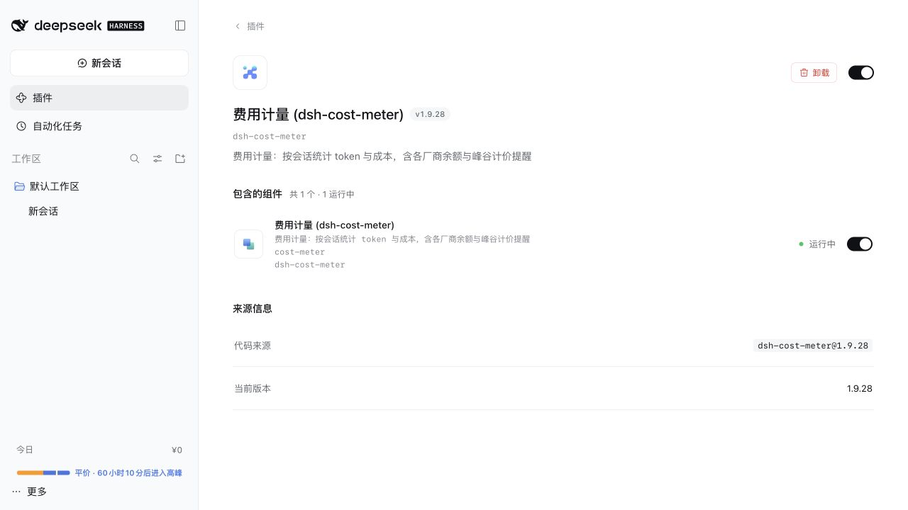
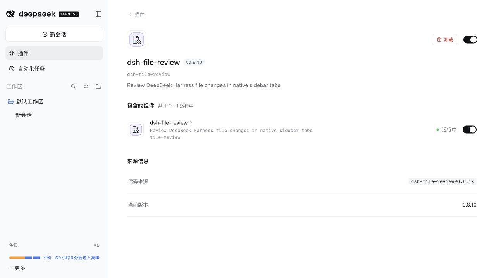
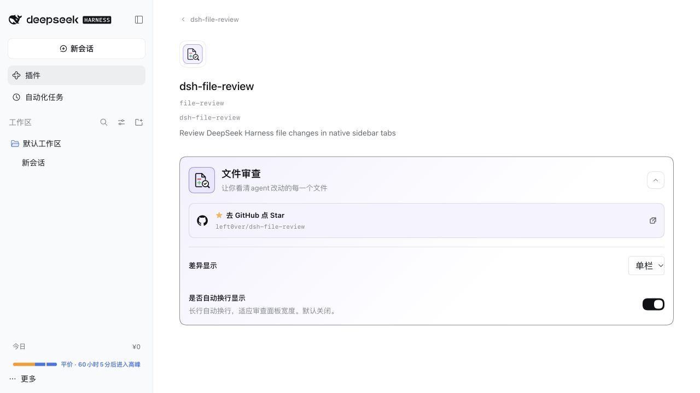

# 候选插件与维护流程验收（2026-10-23）

## 本批结论

两个候选已通过真实 npm 安装、官方插件管理界面的启用、Web 加载、停用和卸载。在原有发布包检查之上，增加了 macOS arm64 的基本运行证据。保持“测试候选”标签；尚不标记完整功能验收通过。

环境：macOS arm64、Node 26.12.1、Harness 0.2.1-rc.2、pnpm 11.22.0，使用项目内固定 TestRuntime/。没有调用付费模型，也没有配置真实服务凭据。本轮没有修改 App 或 Runtime 仓库。

## 实际候选测试

| 检查 | dsh-cost-meter 1.9.28 | dsh-file-review 0.8.10 |
| --- | --- | --- |
| 从 Raw 源取得精确安装参数 | 通过 | 通过 |
| 真实 pnpm 安装、版本核对、默认停用 | 通过 | 通过 |
| 完整 Web Profile 中启用 | 通过 | 通过 |
| 详情页显示组件运行中 | 通过 | 通过 |
| 浏览器入口 | 侧栏显示今日费用与时段 | 配置页显示双栏/单栏与自动换行 |
| 设置写入和页面刷新后保留 | 未专门测试 | 单栏与自动换行设置通过 |
| 停用后的组件卸载 | 侧栏消失、组件已关闭 | 组件已关闭 |
| 官方确认流程卸载 | 通过 | 通过 |
| 卸载后的 Profile 依赖 | 已移除 | 已移除 |

费用插件首次启用时依次出现多项显示功能提示，验收选择保留原样或暂不开启。没有改动插件本身的行为。

本批没有验证真实请求的费用计算、账单/余额、真实模型会话产生的文件变更审阅、macOS x64。没有把包声明兼容替代成这些功能的验收结论。

安装日志、测试 Profile、缓存及连接记录留在本地 TestRuntime/，由维护者查看或手动删除。测试 Web 服务已停止，两个候选已在本次测试 Profile 中卸载；本地缓存及设置仍保留。可运行候选准备脚本重新安装并复测。

## 截图







## 维护流程演练

自动测试从 5 项增加到 9 项，新增覆盖：

- 从 1.0.0 更新到已核验的 1.1.0，再恢复已知有效快照，版本与原始检查证据一并恢复。
- 撤回最后一个候选后生成合法的空索引，且不访问 registry。修复了旧生成器必须至少存在一个候选的限制。
- 恢复快照前检查当前下架名单，拒绝恢复已下架包；快照内容被改动但摘要未同步时拒绝恢复。
- 运行证据仅适用于完全一致的包名、版本、SHA-512 与 Harness 版本；升级后不会沿用旧版本的验收记录。

快照只在本地保存和恢复，不推送、不强制改写 Git 历史。恢复后需要检查 git diff、执行 npm run check，再按正常提交发布。下架记录继续以当前版本为准。

官方 Host 集成测试继续验证真实读取、搜索、缓存、源持久化和本地测试 bundle 的安装生命周期，已去掉对“始终有两个候选”的数量假设，以支持全部撤回。

本次演练没有把模拟升级、撤回或恢复的测试条目发布到公网。Raw 地址及两个候选精确版本保持一致，新增的检查状态为 partial。

## 索引记录

data/verification.json 保存本次人工交互验证的版本与平台证据。构建将匹配的记录写入 public/status.json；没有匹配证据时仍显示 not-run。完整功能验证状态当前为 partial，非 passed。

真实候选测试通过命令：

```sh
npm run candidates:prepare
npm run candidates:web
```

第二条命令只在本机监听，连接 URL 写到 TestRuntime/ready.json（包含本次测试连接令牌，请勿提交），日志写入 TestRuntime/web.log。退出时停止测试服务并保留文件。再次准备前应停止现有测试服务；准备命令会重设其专用测试 Profile 的基础配置。
